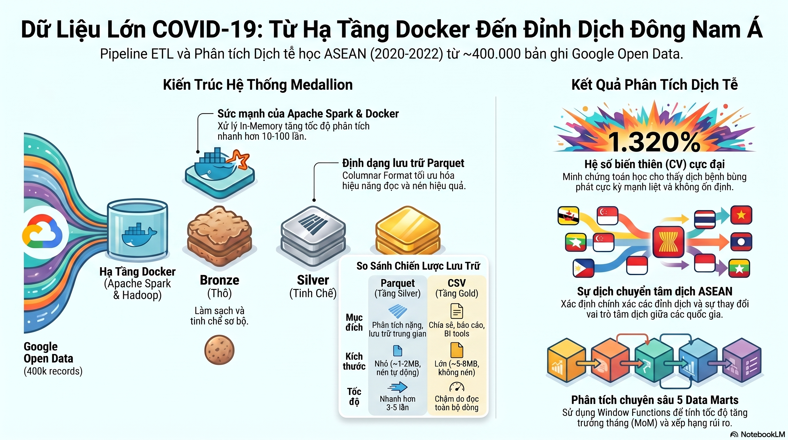

# 🦠 Xử lý và phân tích dữ liệu COVID-19 khu vực Đông Nam Á

Đồ án cuối kỳ học phần **Dữ liệu lớn (858017)** – Khoa Toán - Ứng dụng, Trường Đại học Sài Gòn.

| | |
|---|---|
| **Sinh viên** | Lê Thành Danh (3123580005) · Nguyễn Đăng Tiến (3123580050) |
| **Lớp** | DDU1231 |
| **Giảng viên hướng dẫn** | Vũ Ngọc Thanh Sang |
| **Công nghệ** | Docker Compose · Hadoop HDFS 3.2.1 · Apache Spark (PySpark) · Jupyter · Pandas |

## Giới thiệu

Dự án xây dựng một **pipeline dữ liệu lớn hoàn chỉnh** chạy trên cụm Hadoop/Spark được container hóa bằng Docker, nhằm theo dõi diễn biến dịch COVID-19 tại **11 quốc gia Đông Nam Á**:
Việt Nam, Thái Lan, Malaysia, Singapore, Indonesia, Philippines, Brunei, Campuchia, Lào, Myanmar và Timor-Leste.

- **Nguồn dữ liệu:** [Google COVID-19 Open Data](https://health.google.com/covid-19/open-data/) – file `epidemiology.csv` (toàn cầu).
- **Phạm vi:** 01/01/2020 → 16/09/2022, gồm **394.165 bản ghi** ở 3 cấp (quốc gia, tỉnh/bang, quận/huyện). Phân tích chỉ dùng **cấp quốc gia** (10.864 bản ghi).
- **Kết quả:** 5 data mart trả lời các câu hỏi:
  1. Mỗi tháng, mỗi nước đang ở **mức độ nguy hiểm** nào (lây lan và tử vong)?
  2. Dịch đang **bùng phát hay suy giảm** so với tháng trước (MoM)?
  3. Nước nào là **tâm dịch** đứng đầu Đông Nam Á mỗi tháng?
  4. Bức tranh **tổng kết theo năm** 2020 – 2021 – 2022?
  5. **Đỉnh dịch** của từng nước rơi vào tháng nào?

## Kiến trúc pipeline



```
Google COVID-19 Open Data (epidemiology.csv)
        │  0_thu_thap/get_asean_data.py  (Pandas, đọc theo chunk, lọc 11 nước)
        ▼
data/raw/asean_data.csv ──(docker cp + hdfs dfs -put)──▶ HDFS /data/raw/
        │  1_lam_sach/1a → 1b → 1c
        ▼
HDFS /data/processed/1_cleaned_data            (Parquet)
        │  2_tong_hop/2a, 2b, 2c
        ▼
HDFS /data/processed/2_{monthly,quarterly,yearly}_aggregated
        │  3_datamart/3a → 3e
        ▼
HDFS /data/processed/datamart_*   +   work/output/datamart_*/  (CSV)
        │  4_xuat_hdfs/4_luu_hdfs_kiem_tra.py
        ▼
HDFS /data/export/*_csv
```

## Cấu trúc thư mục

```
Big-Data/
├── README.md
├── docker-compose.yml              # Cụm namenode + datanode + spark-jupyter
├── data/
│   └── raw/                        # Dữ liệu thô
├── docs/
│   ├── bao_cao/                    # Báo cáo PDF, DOCX, XLSX
│   ├── so_do/                      # Sơ đồ kiến trúc, mind map
│   └── trinh_bay/                  # Slide HTML
└── work/                           # Được mount vào container: /home/jovyan/work
    ├── 0_thu_thap/                 # Bước 0: thu thập dữ liệu
    ├── 1_lam_sach/                 # Bước 1: làm sạch
    ├── 2_tong_hop/                 # Bước 2: tổng hợp
    ├── 3_datamart/                 # Bước 3: phân tích
    ├── 4_xuat_hdfs/                # Bước 4: xuất & kiểm tra
    └── output/                     # Kết quả CSV
```

## Nội dung từng thư mục

Mỗi thư mục có README riêng giải thích các file bên trong:

| Thư mục | Nội dung |
|---|---|
| [`data/raw/`](data/raw/) | Dữ liệu thô `asean_data.csv` và bảng mã vùng `index.csv` |
| [`docs/bao_cao/`](docs/bao_cao/) | Báo cáo cuối kỳ (PDF), mô tả pipeline (DOCX), bảng phân tích (XLSX) |
| [`docs/so_do/`](docs/so_do/) | Sơ đồ kiến trúc dữ liệu và mind map |
| [`docs/trinh_bay/`](docs/trinh_bay/) | Slide thuyết trình (HTML) |
| [`work/0_thu_thap/`](work/0_thu_thap/) | Bước 0 – Tải và lọc dữ liệu ASEAN |
| [`work/1_lam_sach/`](work/1_lam_sach/) | Bước 1 – Khám phá và làm sạch dữ liệu |
| [`work/2_tong_hop/`](work/2_tong_hop/) | Bước 2 – Tổng hợp theo tháng / quý / năm |
| [`work/3_datamart/`](work/3_datamart/) | Bước 3 – 5 data mart phân tích |
| [`work/4_xuat_hdfs/`](work/4_xuat_hdfs/) | Bước 4 – Xuất CSV lên HDFS và kiểm tra |
| [`work/output/`](work/output/) | Kết quả CSV của các data mart |

Ngoài ra, `docker-compose.yml` ở thư mục gốc khởi tạo 3 container: **namenode** (HDFS, Web UI cổng `9870`), **datanode** và **spark-jupyter** (PySpark + JupyterLab, cổng `8888`). Thư mục `work/` được mount vào `/home/jovyan/work` trong container.

## Hướng dẫn chạy

**1. Khởi động cụm**

```bash
docker-compose up -d
docker ps        # namenode, datanode, spark-jupyter
```

- HDFS Web UI: http://localhost:9870
- JupyterLab: http://localhost:8888 (lấy token bằng `docker logs spark-jupyter`)

**2. Thu thập dữ liệu** (bỏ qua nếu dùng sẵn `data/raw/asean_data.csv`)

```bash
pip install pandas
python work/0_thu_thap/get_asean_data.py
```

**3. Đưa dữ liệu lên HDFS**

```bash
docker cp data/raw/asean_data.csv namenode:/tmp/asean_data.csv
docker exec namenode hdfs dfs -mkdir -p /data/raw /data/processed /data/export
docker exec namenode hdfs dfs -put -f /tmp/asean_data.csv /data/raw/
docker exec namenode hdfs dfs -ls /data/raw/
```

**4. Chạy pipeline theo thứ tự** (trong container Spark)

```bash
docker exec -it spark-jupyter bash
cd /home/jovyan/work

python 1_lam_sach/1a_doc_raw.py
python 1_lam_sach/1b_kiem_tra_null.py
python 1_lam_sach/1c_lam_sach.py

python 2_tong_hop/2a_theo_thang.py
python 2_tong_hop/2b_theo_quy.py
python 2_tong_hop/2c_theo_nam.py

python 3_datamart/3a_risk.py
python 3_datamart/3b_mom_growth.py
python 3_datamart/3c_ranking.py
python 3_datamart/3d_yearly_summary.py
python 3_datamart/3e_peak.py

python 4_xuat_hdfs/4_luu_hdfs_kiem_tra.py
```

> Bước 1a, 1b chỉ để khám phá dữ liệu và có thể bỏ qua. Bước 3 cần `2a` (và `2c` cho `3d`) chạy trước.

## Cấu trúc dữ liệu trên HDFS sau khi chạy

```
hdfs://namenode:8020/data/
├── raw/asean_data.csv
├── processed/                       (Parquet)
│   ├── 1_cleaned_data/
│   ├── 2_monthly_aggregated/
│   ├── 2_quarterly_aggregated/
│   ├── 2_yearly_aggregated/
│   ├── datamart_1_risk/
│   ├── datamart_2_mom_growth/
│   ├── datamart_3_ranking/
│   ├── datamart_4_yearly_summary/
│   └── datamart_5_peak/
└── export/                          (CSV, hậu tố _csv)
```

## Tài liệu tham khảo

- Google. *COVID-19 Open Data Repository.* https://health.google.com/covid-19/open-data/
- Apache Software Foundation. *Apache Spark 3.5 Programming Guide.*
- Chi tiết lý thuyết và phân tích: [`docs/bao_cao/final_report.pdf`](docs/bao_cao/final_report.pdf)
